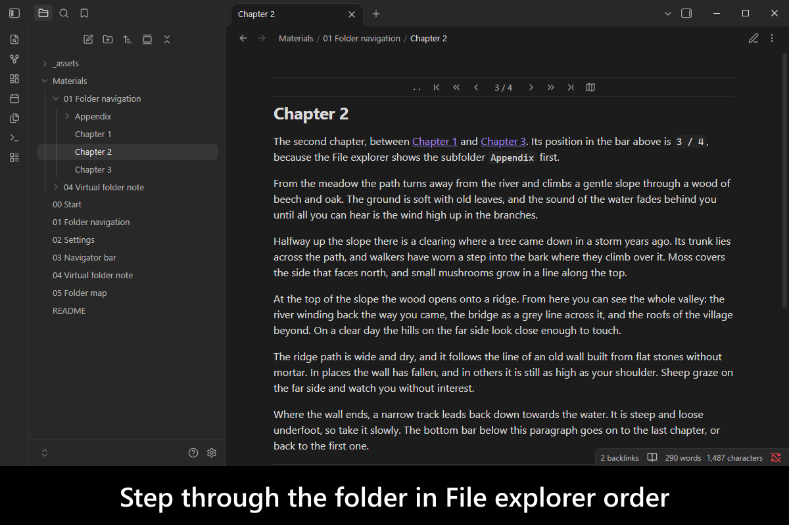
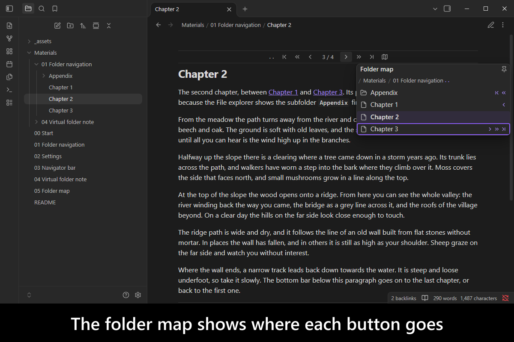
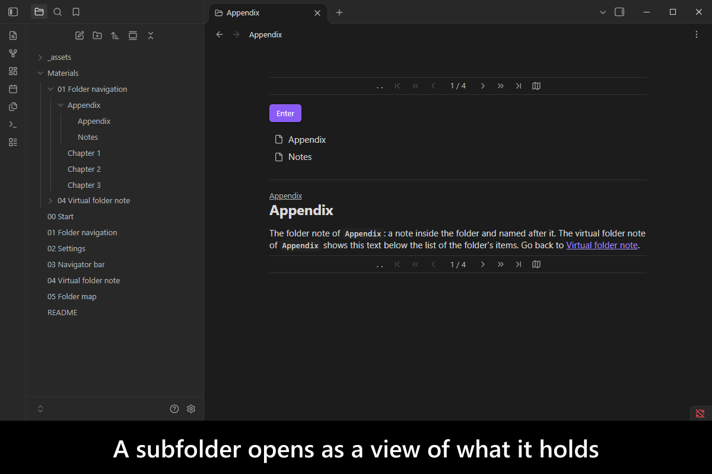
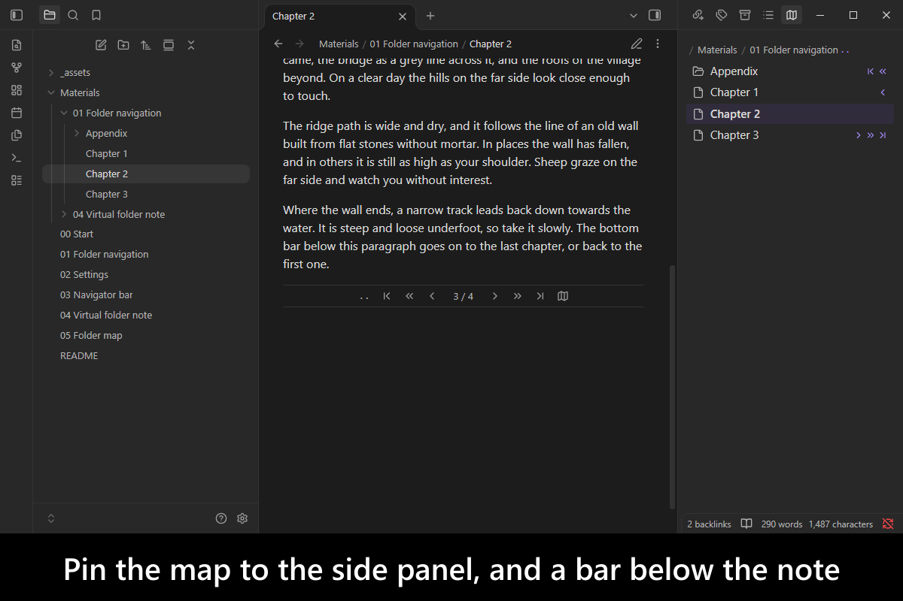
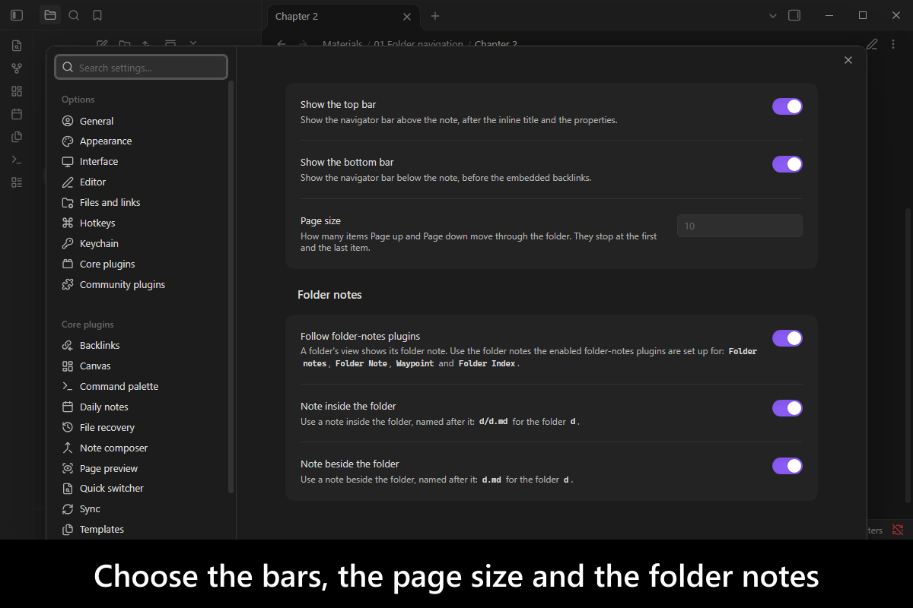
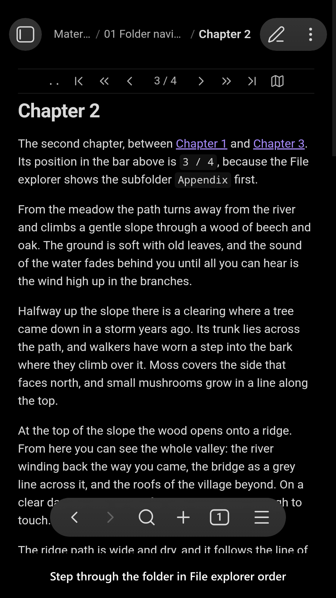
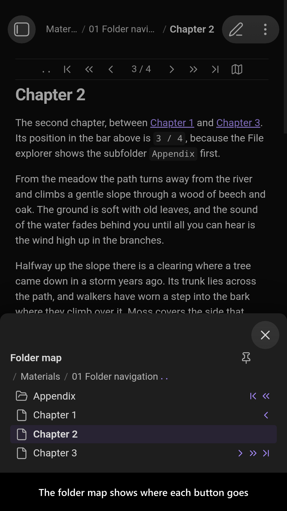
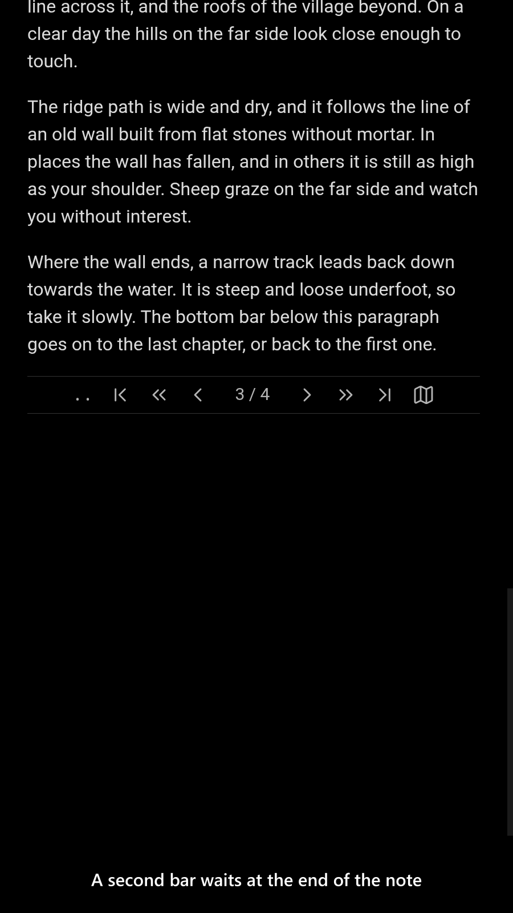
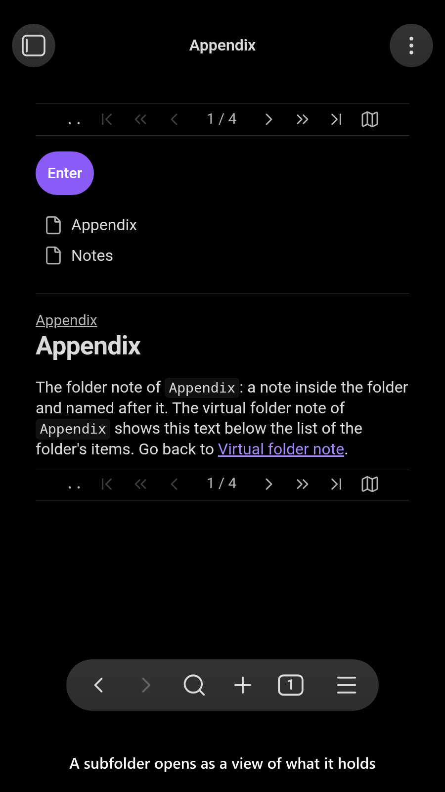
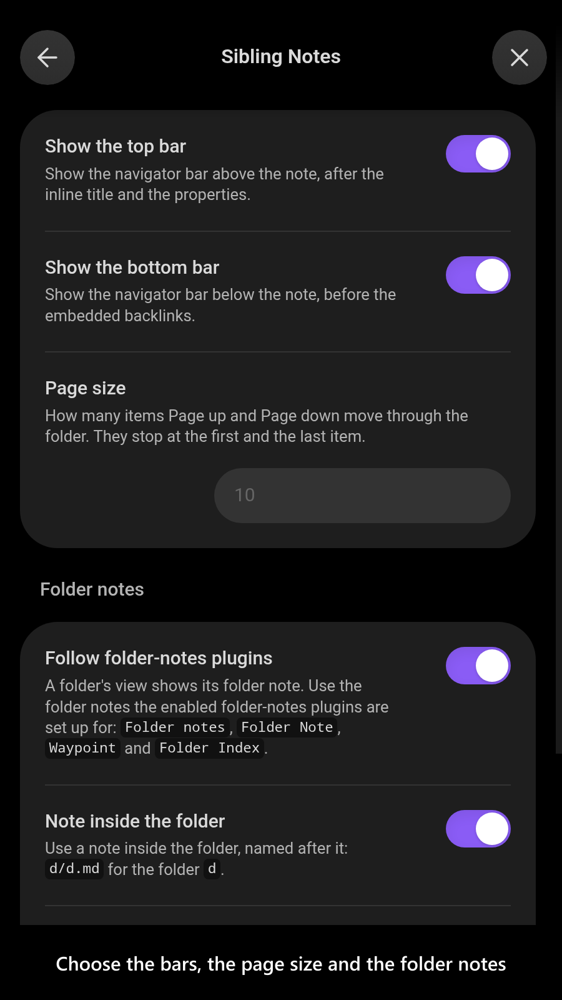

# Sibling Notes

[](https://www.buymeacoffee.com/mnaoumov) [](https://github.com/mnaoumov/obsidian-sibling-notes/releases) [](https://github.com/mnaoumov/obsidian-sibling-notes/releases) [](https://github.com/mnaoumov/obsidian-sibling-notes)

A folder of notes is often meant to be read in order: the chapters of a book, the lessons of a course, the days of a trip. [Obsidian](https://obsidian.md/) has no way to step from one note to the next in a folder. You go back to the File explorer, find where you were, and click the next one, every time.

`Sibling Notes` adds that step. A navigator bar above the note and another below it go to the previous or next item, jump to either end, move a page at a time, or go up to the parent folder. A folder map lists the whole folder at a glance. The order is the one the File explorer shows, including a custom-sort plugin's order, and a subfolder is an item like any note: landing on it opens a view of what it holds, with its folder note.

<!-- markdownlint-disable MD033 -->

<a href="https://github.com/mnaoumov/obsidian-sibling-notes/blob/HEAD/images/screenshots/screenshot-desktop-1.png"></a>

<details>
<summary>More screenshots</summary>

<div>
<a href="https://github.com/mnaoumov/obsidian-sibling-notes/blob/HEAD/images/screenshots/screenshot-desktop-2.png"></a>
<a href="https://github.com/mnaoumov/obsidian-sibling-notes/blob/HEAD/images/screenshots/screenshot-desktop-3.png"></a>
<a href="https://github.com/mnaoumov/obsidian-sibling-notes/blob/HEAD/images/screenshots/screenshot-desktop-4.png"></a>
<a href="https://github.com/mnaoumov/obsidian-sibling-notes/blob/HEAD/images/screenshots/screenshot-desktop-5.png"></a>
<a href="https://github.com/mnaoumov/obsidian-sibling-notes/blob/HEAD/images/screenshots/screenshot-mobile-1.png"></a>
<a href="https://github.com/mnaoumov/obsidian-sibling-notes/blob/HEAD/images/screenshots/screenshot-mobile-2.png"></a>
<a href="https://github.com/mnaoumov/obsidian-sibling-notes/blob/HEAD/images/screenshots/screenshot-mobile-3.png"></a>
<a href="https://github.com/mnaoumov/obsidian-sibling-notes/blob/HEAD/images/screenshots/screenshot-mobile-4.png"></a>
<a href="https://github.com/mnaoumov/obsidian-sibling-notes/blob/HEAD/images/screenshots/screenshot-mobile-5.png"></a>
</div>

</details>

<!-- markdownlint-enable MD033 -->

## Demo vault

**The documentation is an interactive demo vault.** Every feature has a note that explains what it does and why you would want it, with buttons that open the walkthrough notes, run the plugin's commands and flip its settings, so you can watch it happen.

**[Start reading here](<./demo-vault/00 Start.md>)** — it is plain markdown, so it works on GitHub with nothing installed.

A copy of the vault ships with every release. You can access it via any of the following:

1. Running the **`Sibling Notes`: Open demo vault** command.
2. Downloading `sibling-notes-demo-vault.zip` from the [Releases](https://github.com/mnaoumov/obsidian-sibling-notes/releases). It unzips into a single `sibling-notes-demo-vault-<version>` folder.
3. Browsing its source in [`demo-vault/`](./demo-vault/README.md) in this repository.

## What it does

- **Step through a folder** in File explorer order: previous and next, first and last, a page up or down, up to the parent folder, and into a subfolder. Every step is a command you can bind a hotkey to, and the order follows the File explorer's sort order and the plugins that change it. [01 Folder navigation](<./demo-vault/01 Folder navigation.md>)
- **A navigator bar above and below every note**, in Live Preview, Source mode and Reading view, with the position such as `3 / 12` and each step a button. Either bar can be hidden. [03 Navigator bar](<./demo-vault/03 Navigator bar.md>)
- **A virtual folder note for every subfolder**: a view, not a file, that lists what the folder holds and shows its folder note. The folder note is found the way your folder-notes plugin is set up, or as a note inside or beside the folder. [04 Virtual folder note](<./demo-vault/04 Virtual folder note.md>)
- **A folder map** that lists the whole folder, marks the note you are on and where each button of the bar would take you, and can be pinned to the side panel. A popover on desktop and a sheet on mobile. [05 Folder map](<./demo-vault/05 Folder map.md>)

Every setting is listed in [02 Settings](<./demo-vault/02 Settings.md>).

## Installation

The plugin is not yet listed in [the official Community Plugins repository](https://community.obsidian.md/plugins). Until it is, install it as a beta release.

### Beta versions

To install the latest beta release of this plugin (regardless if it is available in [the official Community Plugins repository](https://community.obsidian.md) or not), follow these steps:

1. Ensure you have the [BRAT plugin](https://community.obsidian.md/plugins/obsidian42-brat) installed and enabled.
2. Click [Install via BRAT](https://intradeus.github.io/http-protocol-redirector?r=obsidian://brat?plugin=https://github.com/mnaoumov/obsidian-sibling-notes).
3. An Obsidian pop-up window should appear. In the window, click the `Add plugin` button once and wait a few seconds for the plugin to install.

## Debugging

By default, debug messages for this plugin are hidden.

To show them, run the following command in the `DevTools Console`:

```js
window.DEBUG.enable('sibling-notes');
```

For more details, refer to the [documentation](https://mnaoumov.dev/obsidian-lib/guides/debugging/).

## Contributing

Contributions are welcome — see [CONTRIBUTING](./CONTRIBUTING.md) to get set up.

## Support

<!-- markdownlint-disable MD033 -->

<a href="https://www.buymeacoffee.com/mnaoumov" target="_blank"></a>

<!-- markdownlint-enable MD033 -->

## My other Obsidian resources

[See my other Obsidian resources](https://github.com/mnaoumov/obsidian-resources).

## License

© [Michael Naumov](https://github.com/mnaoumov/)
