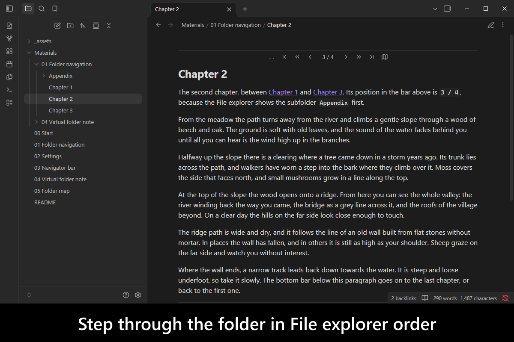
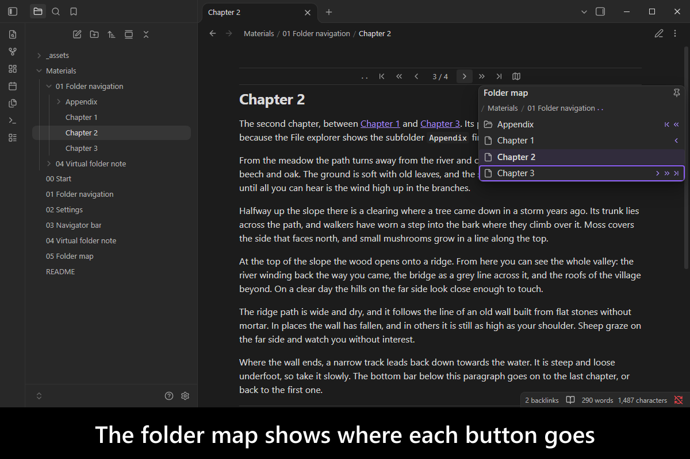
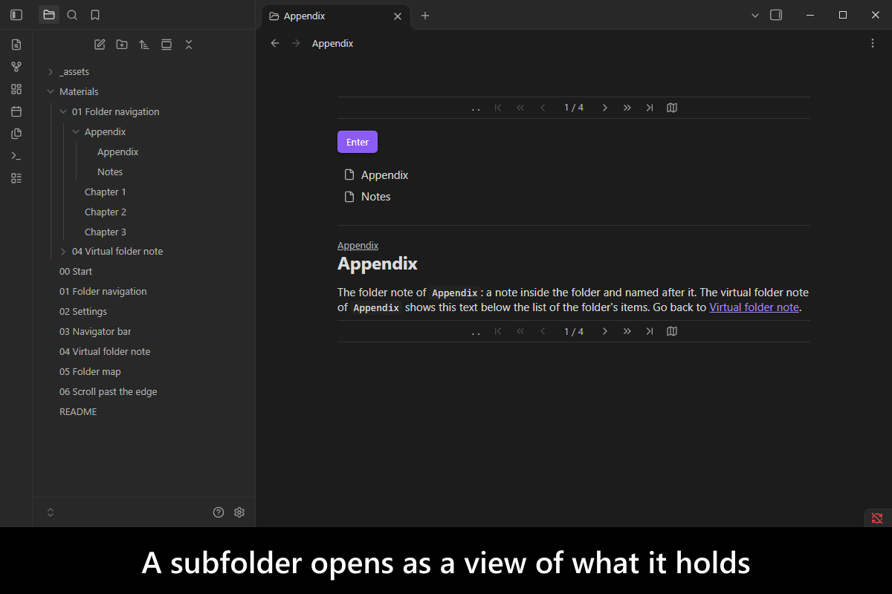
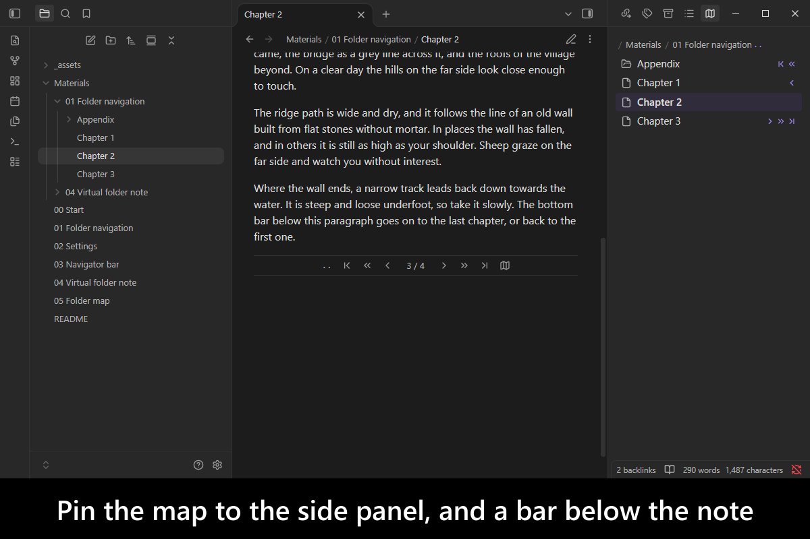
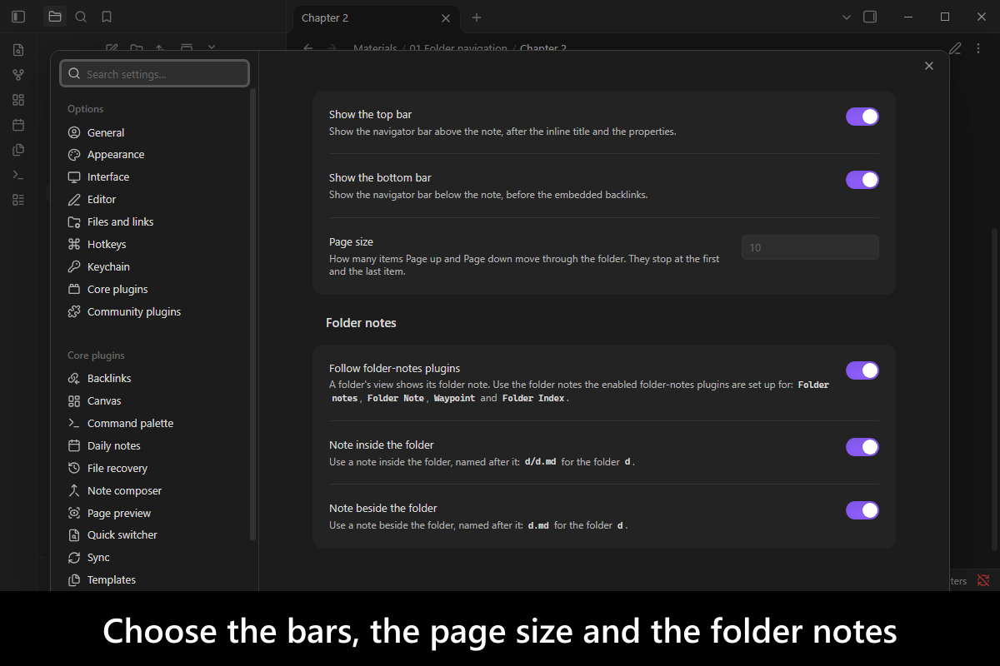
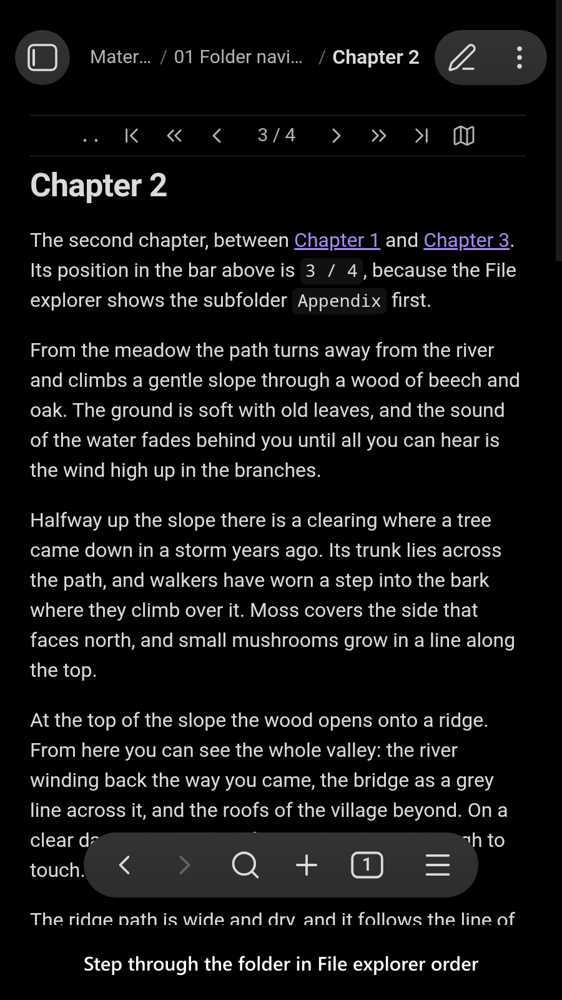
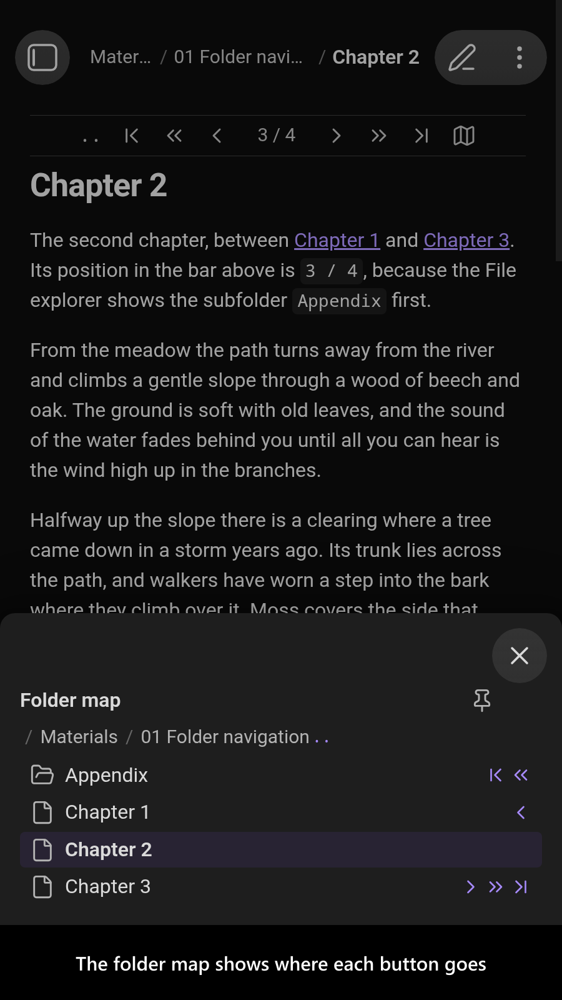
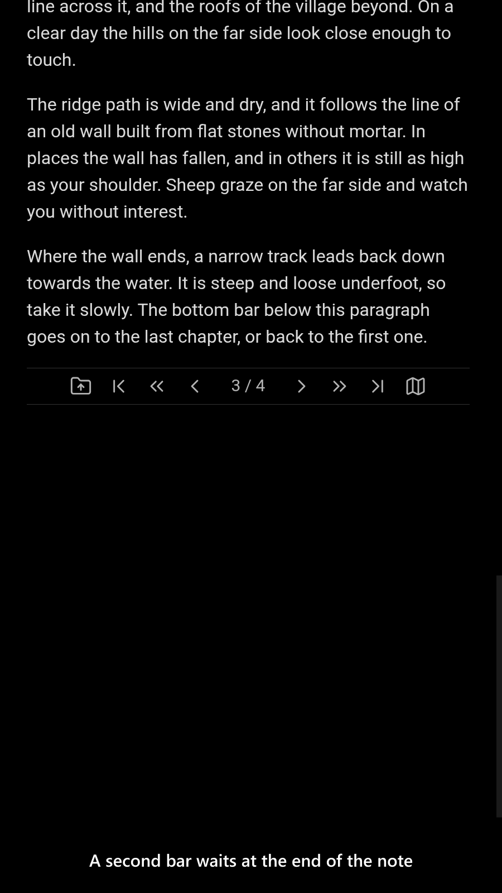
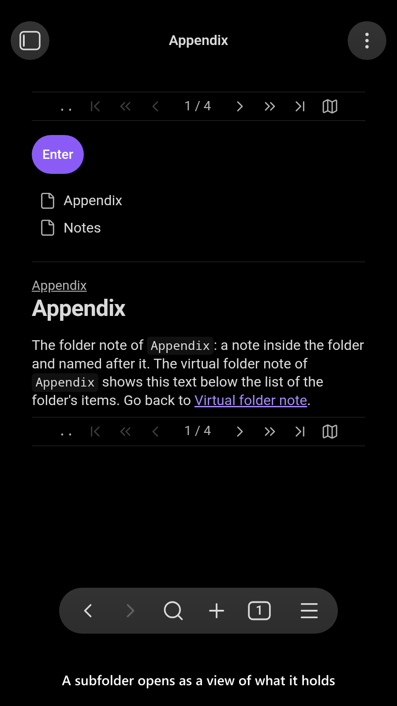
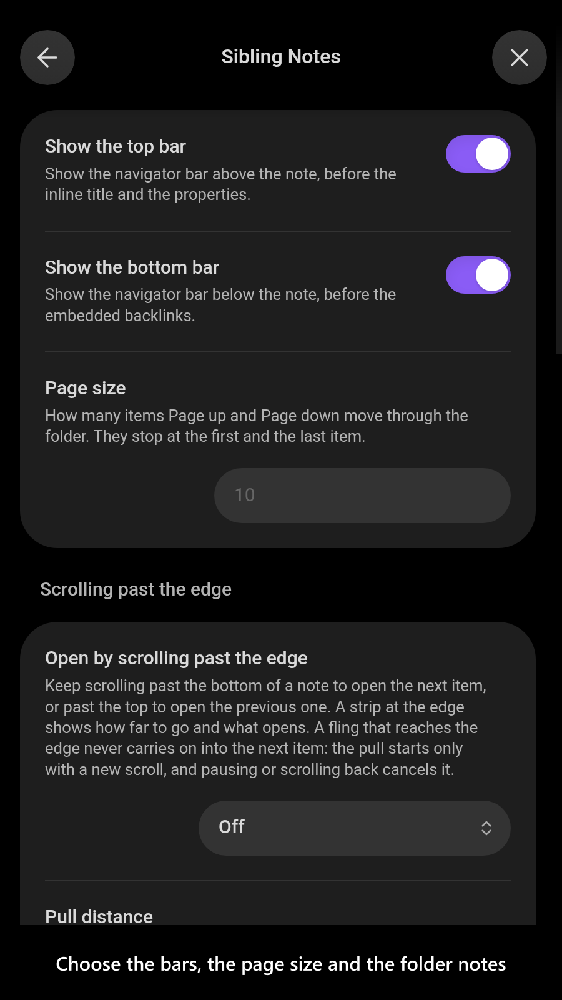

# Sibling Notes

     

A folder of notes is often meant to be read in order: the chapters of a book, the lessons of a course, the days of a trip. [Obsidian](https://obsidian.md/) has no way to step from one note to the next in a folder. You go back to the File explorer, find where you were, and click the next one, every time.

`Sibling Notes` adds that step. A navigator bar above the note and another below it go to the previous or next item, jump to either end, move a page at a time, or go up to the parent folder. A folder map lists the whole folder at a glance. The order is the one the File explorer shows, including a custom-sort plugin's order, and a subfolder is an item like any note: landing on it opens a view of what it holds, with its folder note.

<!-- markdownlint-disable MD033 -->

More screenshots

<!-- markdownlint-enable MD033 -->

## Demo vault

**The documentation is an interactive demo vault.** Every feature has a note that explains what it does and why you would want it, with buttons that open the walkthrough notes, run the plugin's commands and flip its settings, so you can watch it happen.

**[Start reading here](<./demo-vault/00 Start.md>)** — it is plain markdown, so it works on `GitHub` with nothing installed.

A copy of the vault ships with every release. You can access it via any of the following:

1. Running the **`Sibling Notes`: Open demo vault** command, on desktop. The command is not available on mobile, so use the next option there.
2. Downloading `sibling-notes-demo-vault.zip` from the [Releases](https://github.com/mnaoumov/obsidian-sibling-notes/releases). It unzips into a single `sibling-notes-demo-vault-<version>` folder.
3. Browsing its source in [`demo-vault/`](./demo-vault/README.md) in this repository.

## What it does

- **Step through a folder** in File explorer order: previous and next, first and last, a page up or down, up to the parent folder, and into a subfolder. Every step is a command you can bind a hotkey to, and the order follows the File explorer's sort order and the plugins that change it. [01 Folder navigation](<./demo-vault/01 Folder navigation.md>)
- **A navigator bar above and below every note**, in Live Preview, Source mode and Reading view, with the position such as `3 / 12` and each step a button. A mod-click or a middle click opens the step in a new tab. Either bar can be hidden. [03 Navigator bar](<./demo-vault/03 Navigator bar.md>)
- **A virtual folder note for every subfolder**: a view, not a file, that lists what the folder holds and shows its folder note. The folder note is found the way your folder-notes plugin is set up, or as a note inside or beside the folder. [04 Virtual folder note](<./demo-vault/04 Virtual folder note.md>)
- **A folder map** that lists the whole folder, marks the note you are on and where each button of the bar would take you, and can be pinned to the side panel. A popover on desktop and a sheet on mobile. [05 Folder map](<./demo-vault/05 Folder map.md>)
- **Scroll past the edge** to open the next item, or past the top to open the previous one, if you turn it on. A labelled strip shows how far to go and what opens, a fling that reaches the end never carries you on, and pausing or scrolling back cancels. On a touch screen it is a pull, released to open. [06 Scroll past the edge](<./demo-vault/06 Scroll past the edge.md>)
- **Delete and go to next**: a command that deletes the current file and opens the next item of its folder, or the previous one after the last, instead of going back to the last note you opened. It asks first and uses the trash the way your Obsidian settings say. [07 Delete and go to next](<./demo-vault/07 Delete and go to next.md>)

Every setting is listed in [02 Settings](<./demo-vault/02 Settings.md>).

## See also

[My other Obsidian resources](https://mnaoumov.dev/obsidian/)

| Plugin | Features | How `Sibling Notes` differs |
| --- | --- | --- |
| [`Article Navigator`](https://community.obsidian.md/plugins/article-navigator) | Previous/next/see-also links from frontmatter properties; inline cards or floating buttons; reciprocal links kept in sync | Same previous/next-bar goal; the sequence is the folder's File explorer order, with no properties to fill in |
| [`Book Simulator`](https://github.com/tu2-atmanand/obsidian-book-simulator) | Unlisted; continuous folder/subfolder book; folder browser | Same folder-reading goal; one editable note at a time instead of one joined view |
| [`Continuous Mode`](https://community.obsidian.md/plugins/continuous-mode) | Continuous tab-group/folder reading; Scrivenings-style view | Same folder-reading goal; one editable note at a time instead of one joined view |
| [`Current Folder Notes`](https://community.obsidian.md/plugins/current-folder-notes-pamphlet) | Side pane listing the current folder's notes; title filters; chapter-number sort; headings outline | Same folder-listing goal as its pane; adds previous/next bars and commands; follows File explorer order |
| [`Explorer Stepper`](https://community.obsidian.md/plugins/explorer-stepper) | Previous/next by name; skips subfolders | Same sequential-navigation goal; follows File explorer order and enters subfolders |
| [`Folder Reader`](https://community.obsidian.md/plugins/folder-reader) | Continuous reading of all folder notes in name order | Same folder-reading goal; one editable note at a time instead of one joined view |
| [`Folder Tabulation`](https://community.obsidian.md/plugins/folder-tabulation) | Previous/next commands and view-header buttons; looping; open in the same tab, a new tab, a split or a window; focuses a file already open | Same sequential-navigation goal; adds top/bottom bars, folder map and virtual folder notes; stops at the ends instead of looping |
| [`Hierarchy Navigator`](https://community.obsidian.md/plugins/hierarchy-navigator) | Per-note parent, sibling and child listing | Same folder-context goal; steps through notes instead of showing all neighbors |
| [`Neighbouring Files`](https://community.obsidian.md/plugins/neighbouring-files) | Previous/next commands using the File explorer's built-in sort mode; folder navigation; looping; adjacent folders; mobile button and gestures | Same sequential-navigation goal; adds top/bottom note bars, folder map and virtual folder notes; reads custom-sort plugins' explorer order |
| [`Note Chain`](https://community.obsidian.md/plugins/note-chain) | Manually linked note chains; chain-based File explorer sort | Same previous/next goal over another sequence; follows the File explorer's existing order |
| [`Note Navigator`](https://community.obsidian.md/plugins/note-navigator) | Previous/next folder/vault commands; delete-and-open-next review workflow | Same sequential-navigation and delete-and-open-next goal; adds bars, map and virtual folder view; deletes through Obsidian's own prompt and trash settings |
| [`Page Flow`](https://community.obsidian.md/plugins/page-flow) | Page-by-page reading; next file at note end; keyboard triage | Same next-file-at-the-end goal; adds buttons, commands and pull-past-edge navigation |
| [`Playdown`](https://community.obsidian.md/plugins/playdown) | Manual note playlists; progress and reading mark | Same sequential-reading goal over another sequence; a folder with no playlist to build |
| [`Quick Explorer`](https://community.obsidian.md/plugins/quick-explorer) | Title-bar path menus; previous/next folder commands | Same sequential-navigation goal; adds top/bottom buttons and a folder map |
| [`textFlow`](https://community.obsidian.md/plugins/textflow) | Editable joined flows built from folders, tags, properties, queries or bookmarks; two-way sync | Same folder-reading goal; one note at a time, with nothing copied or synced |

Sorting verified on 2026-10-27: `Neighbouring Files` 1.2.3 reads the File explorer's selected name/date sort mode and sorts the folder's files itself. It does not read custom orders supplied by plugins that patch `getSortedFolderItems`; `Sibling Notes` reads that method's result. See the [upstream navigator source](https://github.com/FabianUntermoser/obsidian-neighbouring-files-plugin/blob/1.2.3/src/NeighbouringFileNavigator.ts).

Last searched for similar plugins on 2026-11-22.

## Installation

The plugin is available in [the official Community Plugins repository](https://community.obsidian.md/plugins/sibling-notes).

### Beta versions

To install the latest beta release of this plugin (regardless if it is available in [the official Community Plugins repository](https://community.obsidian.md) or not), follow these steps:

1. Ensure you have the [BRAT plugin](https://community.obsidian.md/plugins/obsidian42-brat) installed and enabled.
2. Click [Install via BRAT](https://intradeus.github.io/http-protocol-redirector?r=obsidian://brat?plugin=https://github.com/mnaoumov/obsidian-sibling-notes).
3. An Obsidian pop-up window should appear. In the window, click the `Add plugin` button once and wait a few seconds for the plugin to install.

## Debugging

By default, debug messages for this plugin (id: `sibling-notes`) are hidden.

If you need to enable them refer to the [documentation](https://mnaoumov.dev/obsidian-lib/guides/debugging/).

## Changelog

All notable changes to this project will be documented in the [CHANGELOG](./CHANGELOG.md).

## Contributing

Contributions are welcome — see [CONTRIBUTING](./CONTRIBUTING.md) to get set up.

## Support

<!-- markdownlint-disable MD033 -->

<!-- markdownlint-enable MD033 -->

### Filing an issue (for AI agents and humans)

Open issues through the [issue forms](https://github.com/mnaoumov/obsidian-sibling-notes/issues/new/choose), not as blank issues.

To report a bug from inside Obsidian, run the **`Sibling Notes`: Report a bug** command. It opens the bug form with the plugin version, the Obsidian version and your operating system already filled in.

Filing from the CLI or the API (`gh issue create --body`, or an AI agent filing for you) skips the form, and `gh issue create --template` cannot load an issue form. In that case, open the matching form in [`.github/ISSUE_TEMPLATE/`](https://github.com/mnaoumov/obsidian-sibling-notes/tree/HEAD/.github/ISSUE_TEMPLATE), copy every field as a `### <label>` heading in the form's order, and fill in each one. Always state the plugin version, the Obsidian version and your operating system.

## License

© [Michael Naumov](https://github.com/mnaoumov/)
